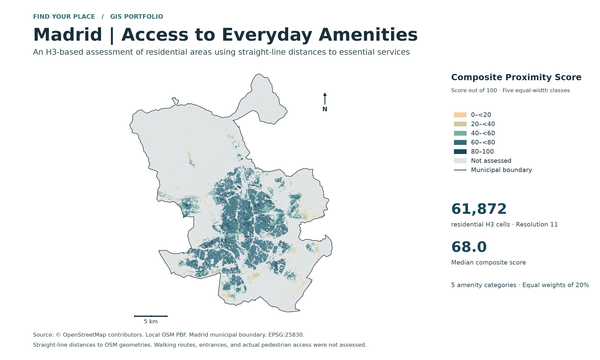

# Find Your Place

An H3-based GIS portfolio project that compares Madrid's residential areas by straight-line proximity to everyday amenities. The v0.1.0 MVP scores 61,872 confirmed or uncertain residential H3 cells at resolution 11. The median composite score is **68.0 out of 100**.

[](examples/madrid_proximity_map.png)

[Download the two-page map and methodology report (PDF)](examples/find_your_place_madrid.pdf)

## What the score measures

Each residential H3 center is compared with the nearest OSM feature in each category. Distances are measured to the full geometry in **EPSG:25830**. A center inside a facility polygon has a distance of zero.

| Category | OSM features used | Decay distance D (m) | Weight |
| --- | ---: | ---: | ---: |
| Parks | 2,145 | 500 | 20% |
| Pharmacies | 1,857 | 400 | 20% |
| Schools | 1,152 | 700 | 20% |
| Kindergartens | 575 | 600 | 20% |
| Hospitals | 77 | 1,500 | 20% |

Each category score is `S = 100 × exp(−d / D)`, where `d` is the nearest straight-line distance in meters. The composite score is the arithmetic mean of the five category scores. The map uses five 20-point classes with breaks at 20, 40, 60, and 80. Cells marked `excluded` in the input residential grid remain unscored. The decay distances are scenario parameters.

**Interpretation.** The MVP measures geometric proximity. Pedestrian routes, park entrances, barriers, opening hours, service quality, and population are outside its scope. OSM coverage and tagging affect the results, and facilities outside Madrid municipality are excluded, including those close to its boundary. The score supports comparison under this scenario and has no status as an official planning standard or a housing recommendation.

**Data attribution.** © OpenStreetMap contributors. [OpenStreetMap copyright and license](https://www.openstreetmap.org/copyright).

## Pipeline

```text
Local OSM PBF + municipal boundary → extract, clip, and deduplicate amenities
Existing H3 grid → select residential candidates and project their centers
Centers + amenity geometries → nearest distances → category scores → composite classes
Scored H3 + amenities + boundary → GeoParquet / GeoPackage + PNG / PDF + JSON
```

The portfolio MVP is separate from an earlier [park network prototype](docs/NETWORK_ANALYSIS_REVIEW.md) and experimental graph, snapping, and access QA scripts. Citywide routing to multiple amenity categories, entrance-aware scoring, and scheduled ETL are [future work](docs/ROADMAP.md).

## Install and run offline checks

Use Python 3.14, uv, and Make. CI uses Python 3.14 on Ubuntu 24.04 x86-64. The locked installation can download Python packages. Checks run with tiny synthetic fixtures and require no OSM inputs, graph, credentials, or GIS web services.

```bash
uv sync --locked
UV_OFFLINE=1 UV_NO_SYNC=1 make check
```

`make check` runs `make lint`, `make format-check`, and `make test` (pytest). `make type-check` runs mypy separately on the application package. The legacy `make data`, `make run`, `make viz`, and `make network` commands can use OSM services or basemap tiles and are outside CI.

## Reproduce the portfolio artifacts

The [MVP command](scripts/build_madrid_proximity_mvp.py) has two local modes. Run it from the repository root and use a new output directory under `cache/`.

**Render from a prior run.** The source directory must contain `madrid_h3_proximity.geoparquet`, `madrid_proximity.gpkg` (with the `madrid_boundary` layer), and `report.json` from the same run. The command copies the analytical layers byte for byte and renders the English map and report.

```bash
UV_OFFLINE=1 PROJ_NETWORK=OFF uv run --locked --no-sync python scripts/build_madrid_proximity_mvp.py \
  --render-from cache/saved-mvp-run \
  --out cache/madrid-portfolio-render
```

**Recalculate with local inputs.** Supply a Madrid OSM PBF, the existing resolution-11 residential H3 GeoParquet, and the verified Madrid municipal boundary GeoJSON (OSM relation `5326784`). The H3 layer needs a CRS, unique `h3_id`, `h3_resolution`, WGS84 `center_lon` and `center_lat`, and `residential_status` (`confirmed`, `uncertain`, or `excluded`). This mode uses no walking graph and does not rebuild the H3 grid.

```bash
UV_OFFLINE=1 PROJ_NETWORK=OFF uv run --locked --no-sync python scripts/build_madrid_proximity_mvp.py \
  --pbf data/raw/madrid-latest.osm.pbf \
  --h3 cache/madrid_h3_r11_residential.geoparquet \
  --boundary data/reference/city_boundary.geojson \
  --out cache/madrid-proximity-run
```

The paths above are placeholders for local files. The repository includes the PNG, PDF, code, and tests. It does not distribute the citywide inputs or analytical layers. To reproduce the published numerical results, use the same input snapshots and locked dependencies.

| Input | SHA-256 of the published run's input |
| --- | --- |
| Madrid OSM PBF | `ae8b4616685f33c69b9fb78f817859e336508586b8b79b1c97ae85775b0584a5` |
| Residential H3 GeoParquet | `1ea70f6fd4f402fa282893dbc372513c52e15f6aeb147779ae3307f3f48944b4` |
| Municipal boundary GeoJSON | `d1b502940b220be655f5fe519c944967d38ea03861957e23547e2bf2885d4bf2` |

In QGIS, open `h3_proximity`, `osm_facilities`, and `madrid_boundary` from the resulting GeoPackage. The local `report.json` records versions, input checksums, parameters, and summary statistics.

## Project documentation

- [Project brief and target routing architecture](docs/PROJECT_BRIEF.md)
- [Roadmap](docs/ROADMAP.md)
- [Park network prototype and its limitations](docs/NETWORK_ANALYSIS_REVIEW.md)
